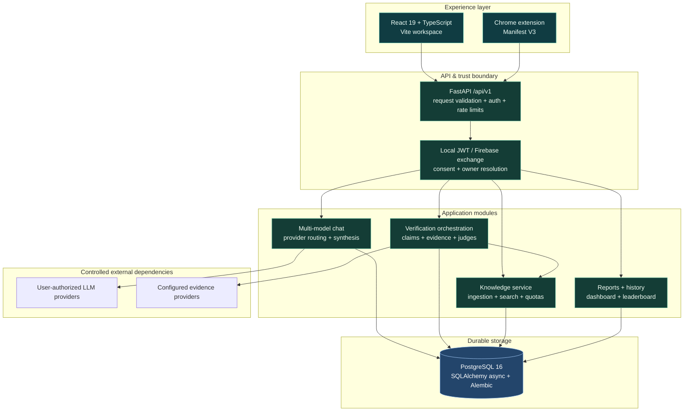
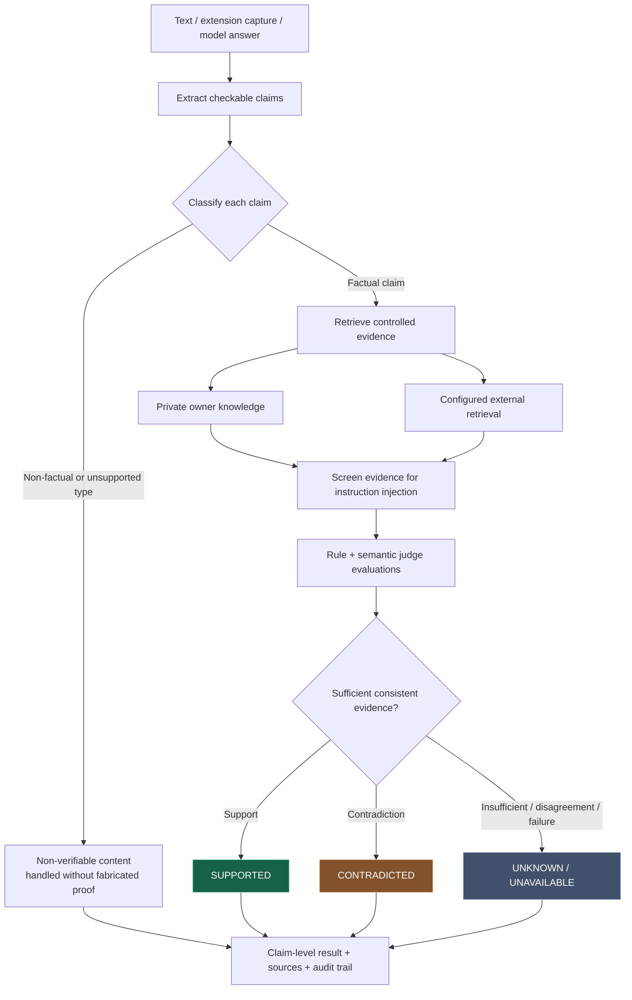
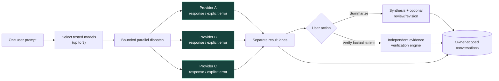
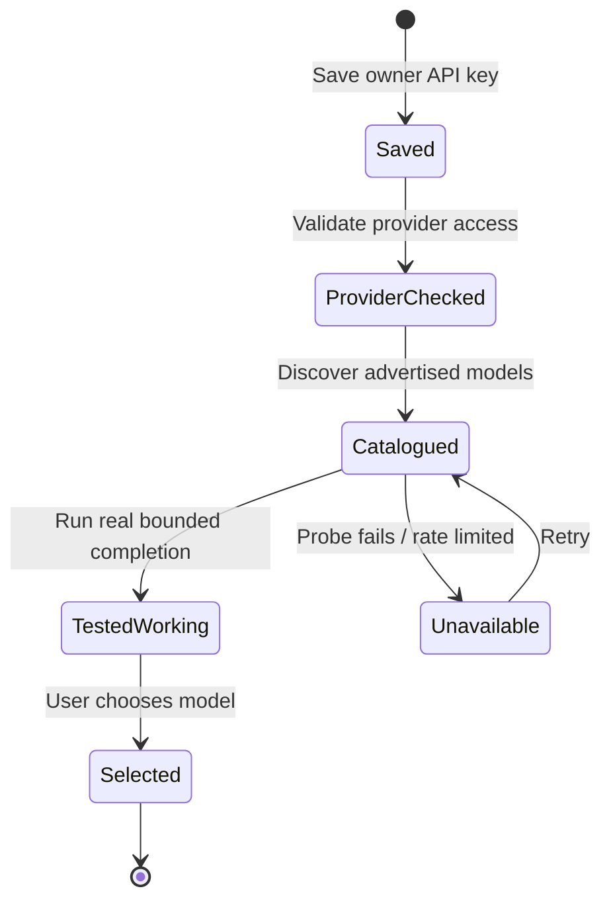
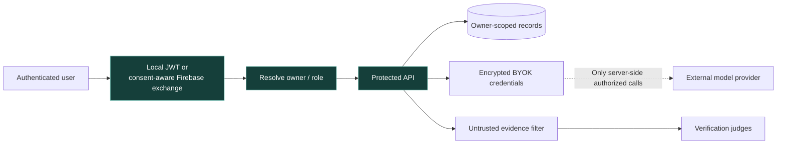

<div align="center">



<br />

# VerifAI

**The evidence-first workspace for AI answers.**

Run models side by side. Break answers into verifiable claims. Inspect sources, contradictions, uncertainty, and an audit trail—without mistaking model agreement for truth.

[](https://github.com/Arunprasath-2717/VerifAI/actions/workflows/ci.yml)
[](backend/)
[](https://fastapi.tiangolo.com/)
[](https://react.dev/)
[](https://www.postgresql.org/)
[](extension/)

**[Explore capabilities](#product-capabilities)** · **[Architecture](#system-architecture)** · **[Verification engine](#verification-engine)** · **[Quick start](#quick-start)** · **[Security](#security--trust-model)** · **[Tests](#quality-gates--test-rehearsal)**

<sub>Development branch: <code>Final</code> · Product and benchmark outputs are not a guarantee of factual accuracy.</sub>

</div>

---

## Why VerifAI exists

A plausible LLM response can be wrong. Three models agreeing can still be wrong. A retrieved page may be irrelevant, poisoned, or outdated.

**VerifAI separates three things that are often conflated:** what a model *said*, what an evidence source *supports*, and what the system *cannot establish*. It combines a multi-model workspace with independent claim-level verification, source inspection, and persisted results.

<table>
<tr>
<td width="33%" valign="top">

### 01 · Compare

One prompt, up to three **selected, tested** models. Separate response lanes with real provider errors, timeouts, and rate-limit outcomes.

</td>
<td width="33%" valign="top">

### 02 · Verify

Extract checkable statements, query configured evidence, evaluate agreement and contradiction, and preserve an explicit **unknown** state.

</td>
<td width="33%" valign="top">

### 03 · Explain

Synthesize answers separately from factual verification. Trace each verification to evidence and structured audit records.

</td>
</tr>
</table>

## Product capabilities

| Capability | What is implemented on `Final` | Boundary |
| :-- | :-- | :-- |
| **Claim verification** | Atomic claim extraction, content classification, evidence retrieval, multiple judge evaluations, decision aggregation | A verdict measures available evidence, **not absolute truth** |
| **Multi-model chat** | Concurrent provider runs, independently visible model lanes, conversation persistence | Provider outages and quota limits stay visible |
| **BYOK model connections** | Per-owner encrypted credentials, provider validation, model discovery, real model-probe selection | A listed or saved model is **not** automatically working |
| **Synthesis & review** | Multi-response summaries and bounded critique/revision workflows | A synthesized answer is **not** evidence validation |
| **Private knowledge base** | Document ingestion, owner-scoped search, persisted chunks, owner storage limits | Private uploads are not shared as global evidence |
| **History & analytics** | Verification and conversation histories, user reports, dashboard metrics | Data is scoped to the authorized account |
| **Leaderboard & benchmarks** | Model views and source-attributed public benchmark snapshots | External benchmark scores are not VerifAI-measured reliability scores |
| **Browser extension** | Chrome Manifest V3 content capture and ingestion workflow | Capture only from supported interfaces and permitted contexts |
| **Safety controls** | JWT/Firebase enrollment boundary, credential redaction, request/rate limits, SSRF and prompt-injection checks | Defense in depth; not a substitute for independent security review |

> [!IMPORTANT]
> This README describes the **`Final` branch**. `main` may contain an older implementation until the pull request is reviewed and merged. Real provider calls require the user's own valid credentials, permissions, and quota.

### Experience map

| Page / route | What happens there |
| :-- | :-- |
| `/` | Cinematic product landing experience |
| `/verify` | Submit text and inspect claim-level evidence and outcomes |
| `/chat` | Connect, test, compare, and synthesize model responses |
| `/knowledge-base` | Manage private source documents |
| `/leaderboard` | Explore model comparisons and source-backed benchmark views |
| `/dashboard`, `/reports`, `/history` | Review activity, summaries, and previous work |
| `/settings` | Provider configuration and account/workspace settings |

---

## System architecture

VerifAI is a **modular monolith**: the backend owns authentication, policy, inference orchestration, evidence evaluation, and database writes; the web app and Chrome extension are clients, not sources of authority.



**Architecture decisions:** modular backend services, repository/data-access boundaries, provider adapters, bounded concurrency, and explicit failure states. The database is authoritative for stored users, messages, evidence, audit records, and private content.

<details>
<summary><strong>Runtime components and responsibilities</strong></summary>

| Component | Primary responsibility | Source |
| :-- | :-- | :-- |
| Frontend | Authentication UI, model lanes, verification views, reports | [`frontend/src/`](frontend/src/) |
| HTTP/API | Typed request/response schemas, endpoints, middleware | [`backend/app/api/`](backend/app/api/) |
| Authentication | Local credentials, Firebase token exchange, consent handling | [`backend/app/modules/auth/`](backend/app/modules/auth/) |
| Verification | Claim pipeline, judges, verdict aggregation, audit ordering | [`backend/app/modules/verification/`](backend/app/modules/verification/) |
| Evidence | Configured retrieval adapters and evidence representation | [`backend/app/modules/evidence/`](backend/app/modules/evidence/) |
| LLM/Chat | Provider adapters, multi-model orchestration, synthesis | [`backend/app/modules/chat/`](backend/app/modules/chat/) |
| Knowledge | Private ingestion, search, owner quota enforcement | [`backend/app/modules/knowledge/`](backend/app/modules/knowledge/) |
| Persistence | ORM models, repositories and migration history | [`backend/app/repositories/`](backend/app/repositories/), [`backend/alembic/`](backend/alembic/) |

</details>

## Verification engine

The engine operates on **claims**, not a single opaque confidence score. Evidence and model judgments are recorded separately; uncertainty is preserved when reliable support is missing or conflicting.



**Important distinctions:** a model's *answer*, a judge's *assessment*, a citation's *existence*, and the *reliability of the underlying source* are not equivalent. Missing or unsafe evidence must not be converted into a “verified” answer. Concurrency is bounded, and claim/audit ordering is retained. Claims sharing a database session are processed safely rather than sharing a session across concurrent tasks.

## Multi-model orchestration

The comparison experience deliberately separates **execution**, **synthesis**, and **verification**. Users choose up to three models *after* testing real completions; an unavailable model remains unavailable instead of being replaced by a fake answer.



<details>
<summary><strong>BYOK model lifecycle: saved is not tested</strong></summary>



The backend encrypts supported saved provider credentials and enforces owner-level access. External service availability, model names, cost, supported formats, and limits can change at any time. **Never commit API keys or put them into README examples.**

</details>

## Security & trust model



| Boundary | Engineering behavior |
| :-- | :-- |
| **Identity & consent** | Local JWT authentication and a consent-aware Firebase enrollment/exchange; direct Firebase bearer access cannot silently provision accounts |
| **Account isolation** | Opaque Firebase subjects are scoped to provider-derived identifiers; email collisions do not automatically link accounts |
| **Atomic registration** | User and required legal consent persist in one transaction or roll back together |
| **Secrets** | Provider keys are encrypted per owner; server handles external requests, not the public frontend bundle |
| **Request safety** | Typed validation, request size and rate limits, authorization, SSRF defenses, untrusted-content and prompt-injection checks |
| **Resource limits** | Bounded claims, judge/token budgets, timeouts and per-owner persistent private-knowledge quotas |
| **Data integrity** | PostgreSQL transactions, Alembic migrations, ordered audits, source attribution and explicit failure states |

> [!WARNING]
> VerifAI is a research/developer project, **not** a certified fact-checking service, a substitute for professional advice, or a production security certification. Retrieved content can be unreliable; judge decisions can be wrong. Review high-stakes conclusions with original, authoritative sources.

---

## Technology stack

| Area | Technologies |
| :-- | :-- |
| **Frontend & motion** | React 19, TypeScript, Vite 8, Tailwind CSS, Motion, Anime.js, Lenis |
| **API** | Python, FastAPI, Pydantic, asynchronous request handling |
| **Identity** | Argon2id password hashing, signed application JWTs, optional Firebase integration |
| **Persistence** | PostgreSQL 16, SQLAlchemy 2 async, asyncpg, Alembic |
| **LLM layer** | Provider adapters and user-configured OpenAI-compatible / native provider pathways |
| **Evidence** | Local/private retrieval, configured search adapters, deterministic and semantic judge layers |
| **Companion** | Chrome Manifest V3 extension |
| **Quality** | pytest, Ruff, mypy, Bandit, pip-audit, npm audit, browser smoke tests, GitHub Actions |

### Repository structure

```text
VerifAI/
├── backend/
│   ├── app/
│   │   ├── api/v1/endpoints/    # Versioned HTTP resources
│   │   ├── core/                # Config, auth dependencies, security, DB
│   │   ├── modules/             # Verification, chat, knowledge, judges
│   │   ├── models/              # ORM entities
│   │   ├── repositories/        # Data access
│   │   └── schemas/             # Typed API contracts
│   ├── alembic/                 # Schema migrations
│   └── tests/                   # Backend regressions
├── frontend/
│   ├── src/                     # React app, routes, UI and API clients
│   ├── public/                  # Cinematic landing assets
│   └── tests/                   # UI, browser and security regressions
├── extension/                   # Chrome MV3 companion
├── benchmark/                   # Evaluation cases and validation
├── database/                    # PostgreSQL initialization
├── docs/                        # Architecture, security and module guides
├── scripts/                     # Smoke, benchmarks and operations
├── .github/workflows/           # CI and benchmark refresh
├── docker-compose.yml
└── README.md
```

---

## Quick start

The instructions below target a **local development workspace on `Final`**, not a hosted production deployment.

### Requirements

- Git, Docker Engine / Docker Desktop and the Docker Compose plugin
- Node.js **22.12+** and npm for the Vite 8 frontend (Node 20.19+ also supported by Vite)
- Python **3.12** recommended for backend tooling and CI parity
- Optional: user-owned model/retrieval credentials to enable external calls

### 1. Clone and configure

```bash
git clone https://github.com/Arunprasath-2717/VerifAI.git
cd VerifAI
git switch Final

cp .env.example .env
cp frontend/.env.example frontend/.env
```

Edit the root `.env`. The Compose stack requires three private values. Note: Compose forwards only the backend environment variables explicitly listed in `docker-compose.yml`:

| Variable | What to provide |
| :-- | :-- |
| `POSTGRES_PASSWORD` | A strong database password for the local PostgreSQL container |
| `JWT_SECRET` | A high-entropy application token-signing secret |
| `PROVIDER_CREDENTIAL_ENCRYPTION_KEY` | A cryptography **Fernet** key for stored BYOK credentials |

Generate values locally:

```bash
# Signer and database password — generate separate values
openssl rand -hex 32
openssl rand -hex 32

# Fernet key — requires python package 'cryptography'
python3 -c "from cryptography.fernet import Fernet; print(Fernet.generate_key().decode())"
```

Paste the generated values into your **local** `.env`. Never commit, publish, screenshot, or paste real secrets into issues. Firebase fields in `frontend/.env` are optional for local-provider-independent development; configure a real Firebase project only when using that sign-in flow.

### 2. Start PostgreSQL and the API

For local development **without Firebase**, the backend needs `FIREBASE_AUTH_ENABLED=false`. The current Compose file does not forward that variable from `.env`, so use a temporary override:

```bash
cat > /tmp/verifai-compose-local.yml <<'YAML'
services:
  backend:
    environment:
      FIREBASE_AUTH_ENABLED: "false"
YAML

docker compose -f docker-compose.yml -f /tmp/verifai-compose-local.yml up --build -d
docker compose ps
curl -fsS http://127.0.0.1:8000/api/v1/health
curl -i http://127.0.0.1:8000/api/v1/ready
```

The Compose setup binds the API to **127.0.0.1:8000** and PostgreSQL to **127.0.0.1:5432** by default. Liveness and readiness are different: `health` reports the running process; `ready` checks critical dependencies. A **503 readiness** response is intentional if Firebase authentication is enabled without a configured Firebase project. To use Firebase, pass `FIREBASE_AUTH_ENABLED=true` and the valid `FIREBASE_PROJECT_ID` into the backend environment and configure matching web identifiers in `frontend/.env`.

> [!NOTE]
> Run database migrations appropriate to your environment before relying on a migrated schema: `backend/alembic.ini` is the canonical migration configuration. The Compose backend may initialize missing schema in development; that is **not** a substitute for reviewing and applying Alembic migrations during deployment.

### 3. Start the web app

```bash
cd frontend
npm ci --legacy-peer-deps
npm run dev
```

| Local URL | Service |
| :-- | :-- |
| [localhost:3000](http://localhost:3000) | React workspace |
| [localhost:8000/api/v1/health](http://localhost:8000/api/v1/health) | API liveness |
| [localhost:8000/api/v1/ready](http://localhost:8000/api/v1/ready) | API readiness |
| [localhost:8000/docs](http://localhost:8000/docs) | Interactive FastAPI OpenAPI reference |

If the browser cannot reach your backend, confirm `VITE_API_BASE_URL` and your development proxy/CORS setup. The frontend defaults to same-origin `/api/v1`; frontend environment configuration and backend CORS settings must match the way you serve them.

### 4. Use the workspace

1. Register or sign in and complete required consent.
2. **Verify** a factual passage and examine its claim-level outcomes.
3. Add private documents to the **Knowledge Base** if you want owner-scoped context.
4. In **Chat**, configure a supported BYOK provider, save/test its key, probe a real model, and select up to three working models.
5. Compare the output lanes. Ask for **Summarize** or run **Verify** when factual support matters.

<details>
<summary><strong>Alternative: local Python API without Docker's backend container</strong></summary>

Use an accessible PostgreSQL instance and configure `backend/.env` with a suitable `DATABASE_URL`, token secret and other required settings:

```bash
python3 -m venv .venv
source .venv/bin/activate
pip install -r backend/requirements-dev.txt
cp backend/.env.example backend/.env

# After editing backend/.env with valid local configuration:
cd backend
../.venv/bin/alembic -c alembic.ini upgrade head
cd ..
PYTHONPATH=backend .venv/bin/uvicorn app.main:app --host 127.0.0.1 --port 8000 --reload
```

Don't run two backend processes simultaneously on port 8000. Stop Compose's backend service when using the local Uvicorn process.

</details>

<details>
<summary><strong>Operational commands & troubleshooting</strong></summary>

```bash
docker compose ps
docker compose logs --tail=100 backend
docker compose logs --tail=100 db
docker compose -f docker-compose.yml -f /tmp/verifai-compose-local.yml down
```

- **503 readiness:** Inspect DB connectivity and authentication configuration; do not suppress a legitimate readiness failure.
- **401 protected API response:** Sign in and supply a valid authenticated session.
- **Provider test fails:** Check the user's key, model ID, quota, provider access, network, and configured endpoint; do not substitute a fabricated response.
- **Frontend loads but API requests fail:** Check port 8000, proxy settings, `VITE_API_BASE_URL` and CORS.
- **Data safety:** `docker compose down` (or the equivalent multi-file command) preserves the named PostgreSQL volume; **`down -v` deletes volumes**. Back up important data before schema updates or destructive operations.

</details>

---

## API surface

All application routes are versioned beneath `/api/v1`. Authorization and request schemas are endpoint-specific; use [`/docs`](http://localhost:8000/docs) for the live contract.

| Method | Route | Purpose |
| :-- | :-- | :-- |
| `GET` | `/health`, `/ready` | Liveness and dependency readiness |
| `POST` | `/auth/register`, `/auth/login`, `/auth/firebase` | Local registration, session login and consent-aware Firebase exchange |
| `POST` | `/verification` | Verify submitted content |
| `GET` | `/verification/{verification_id}` | Retrieve the persisted verification |
| `POST` | `/ingest` | Ingest supported browser or user content |
| `POST` | `/knowledge/upload`, `/knowledge/search` | Private document upload and search |
| `GET` | `/providers/chat-models` | Discover eligible BYOK chat models |
| `POST` | `/providers/chat-models/probe` | Run a real, bounded model completion test |
| `POST` | `/chat/conversations` | Create a conversation |
| `POST` | `/chat/conversations/{id}/messages` | Dispatch conversation message to selected models |
| `POST` | `/chat/conversations/{id}/messages/{message_id}/summarize` | Synthesize a message |
| `GET` | `/models/public-benchmarks` | Externally sourced benchmark snapshot |
| `GET` | `/reports/analytics` | Owner-scoped reports and analytics |

*Paths in the table are relative to `/api/v1`. Authorization may be required.*

## Quality gates & test rehearsal

The [fullstack CI workflow](.github/workflows/ci.yml) checks backend quality, isolated regression tests, dependency audit, frontend TypeScript, security checks, build, and smoke tests. The [benchmark workflow](.github/workflows/refresh-public-leaderboard.yml) is a separate data refresh concern.

```bash
# From repository root, after Python development dependencies are installed
.venv/bin/ruff check backend scripts benchmark
.venv/bin/ruff format --check backend scripts benchmark
.venv/bin/mypy backend/app --follow-imports=silent --ignore-missing-imports
.venv/bin/pytest benchmark/tests -q

# Backend integration tests require an isolated test database:
VERIFAI_TEST_DATABASE_URL=sqlite+aiosqlite:////tmp/verifai_readme_test.sqlite \
  .venv/bin/pytest backend/tests -q

# From frontend/
npm ci --legacy-peer-deps
npm run lint
npm run test:security
npm run build
npm run test:smoke
npm run test:browser
```

**Most recent documented rehearsal (2 November 2026):** GitHub Actions on `Final` passed its frontend, Python 3.12 backend, and fullstack status jobs; the backend run reported **1,412 passed, 1 PostgreSQL-specific skipped**. A separate isolated PostgreSQL regression reported **1,413 passed**. Results are a dated snapshot, not a future CI guarantee.

[](https://github.com/Arunprasath-2717/VerifAI/actions/workflows/ci.yml) · [Engineering audit evidence](docs/security/PRODUCTION_AUDIT_2026-11-02.md)

> [!CAUTION]
> **Passing CI does not certify production deployment.** Production-equivalent migrations with real historical data, backup/restore, load/performance, external model-provider integration, telemetry, and media licensing still require independent validation.

---

## Documentation index

| Read next | Focus |
| :-- | :-- |
| [Complete technical guide](docs/VERIFAI_COMPLETE_TECHNICAL_GUIDE.md) | Broad product and engineering reference |
| [Multi-model orchestration](docs/MULTI_MODEL_CHAT_ORCHESTRATION_MODULE.md) | Concurrent model execution, synthesis and review |
| [BYOK workflow](docs/BYOK_CHAT.md) | Credential lifecycle and model probes |
| [Backend deep dive](docs/BACKEND_DEEP_DIVE.md) | Implementation architecture and services |
| [Frontend/backend contract](docs/FRONTEND_BACKEND_CONTRACT.md) | API/UI coordination |
| [Threat model](docs/SECURITY_THREAT_MODEL.md) | Trust boundaries and attack classes |
| [API security matrix](docs/API_SECURITY_MATRIX.md) | Endpoint protection expectations |
| [Production engineering audit](docs/security/PRODUCTION_AUDIT_2026-11-02.md) | Rehearsal evidence, limitations and release gates |
| [Security policy](SECURITY.md) | Disclosure and security guidance |
| [Product overview](PRODUCT.md) | Product positioning |

### Project status, contributing & license

- **`Final`** is the active advanced workspace and development target described here; merge to `main` only after review and CI approval.
- For contributions, create a focused branch, document meaningful architectural decisions, write regression tests, and open a pull request. No real keys, personal data, or invented evaluation scores in commits.
- **Licensing:** There is currently no repository-root `LICENSE` file. Publicly visible code is **not automatically open-source licensed**. Seek the owner's permission before redistributing or reusing it.

---

<div align="center">

### Better answers begin with better evidence.

**VERIFAI** · Compare perspectives · Verify claims · Keep uncertainty visible

[Back to top ↑](#verifai) · [Repository](https://github.com/Arunprasath-2717/VerifAI) · [Review changes](https://github.com/Arunprasath-2717/VerifAI/compare/main...Final?expand=1)

<sub>Animated hero respects reduced-motion preferences. In clients that do not animate SVG, the illustration remains readable as a static banner.</sub>

</div>
