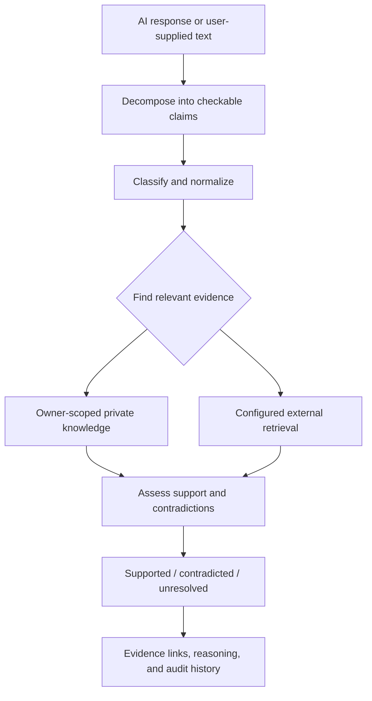
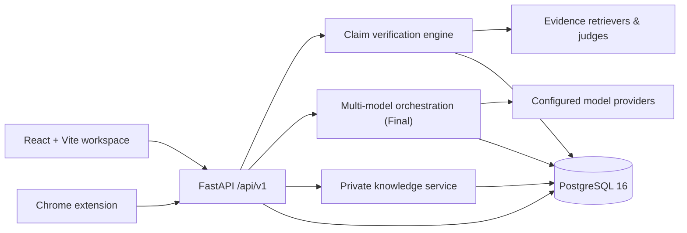

<div align="center">

# VerifAI

### Evidence-first verification for AI-generated answers

**Don't just compare what AI models say. Examine what the evidence supports.**

[](https://github.com/Arunprasath-2717/VerifAI/actions/workflows/backend-ci.yml)
[](https://www.python.org/)
[](https://react.dev/)
[](https://fastapi.tiangolo.com/)
[](https://www.postgresql.org/)

[Explore the product](#the-product) · [How it works](#how-verification-works) · [Get started](#get-started) · [Documentation](#documentation)

</div>

---

## The problem

Large language models can produce fluent answers that are inaccurate, outdated, unsupported, or inconsistent with other generations. Comparing model outputs can expose disagreement, but **agreement is not proof**.

**VerifAI** turns an AI-generated response into a reviewable verification workflow: extract checkable claims, retrieve relevant evidence, evaluate support or contradiction, and preserve a trace of the decision. Its newer workspace also lets users run a single prompt across independently tested models, inspect each answer, and request synthesis or verification.

> **Product principle:** A confident answer is not a verified answer. VerifAI distinguishes observed evidence, model-generated interpretation, and information that remains unresolved.

## The product

| Experience | What you can do |
| --- | --- |
| **Verify** | Submit text, split it into atomic claims, and inspect evidence-backed verification outcomes. |
| **Evidence workspace** | Retrieve supporting context from an owner-scoped private knowledge base and configured external evidence sources. |
| **Multi-model chat** | Send one prompt to up to three working, independently selected models; see their answers side by side. |
| **Summarize & refine** | Turn multiple model responses into a structured synthesis; optionally use bounded critique/revision cycles. |
| **Dashboard & history** | Review completed verifications, claim activity, evidence sources, and saved conversations. |
| **Benchmarks & reports** | Inspect model comparison views and evaluation information while keeping externally published scores distinct from VerifAI's own measurements. |
| **Browser companion** | Verify AI-generated content from supported web chat interfaces using the Chrome extension. |

### What is available on each branch?

This repository has two distinct product baselines. The advanced product experience is under active development on **`Final`**; **`main`** contains the earlier verification-first implementation. Features are not silently presented as available on both branches.

| Capability | `main` | `Final` |
| --- | :---: | :---: |
| Claim extraction, evidence retrieval, and verification API | ✓ | ✓ |
| Private knowledge base and owner-scoped evidence | ✓ | ✓ |
| Initial React verification dashboard | ✓ | ✓ |
| Chrome browser extension | ✓ | ✓ |
| Multi-provider bring-your-own-key (BYOK) connections | — | ✓ |
| Concurrent multi-model chat and per-model answer lanes | — | ✓ |
| Answer synthesis, critique/revision flows, and expanded reports | — | ✓ |
| Redesigned authenticated workspace and enhanced model leaderboard | — | ✓ |

**For the complete current workspace described below, check out `Final`.** A documentation-only merge into `main` does not by itself ship the advanced features.

## How verification works



VerifAI aims to make each step inspectable. If retrieval fails, the available evidence is inconclusive, or a provider is unavailable, the application should surface an **unknown, unavailable, or review-required state** instead of inventing certainty.

### Multi-model workflow (`Final`)

1. **Connect:** Add a provider using a user-owned API key; the backend stores supported credentials encrypted per authenticated owner.
2. **Test:** Discover models and run an actual bounded completion before marking a model as working. A catalog listing alone does not mean a model is usable.
3. **Compare:** Choose up to three tested models, submit a prompt once, and inspect the independent responses, including failures or rate limits.
4. **Synthesize:** Request a combined answer or a structured deliverable such as a project idea, PRD, or architecture proposal. Optional review cycles can refine it.
5. **Verify:** Run separate evidence assessment when factual confidence matters; never equate multi-model agreement with verified truth.
6. **Revisit:** View saved conversation results, synthesis, and verification history.

Provider access, quotas, costs, and model availability depend on each provider and account. A suggested architecture or PRD is a proposal—not a factual certification.

## Technology & architecture

VerifAI follows a modular-monolith architecture: the user interface displays results, while authentication, orchestration, retrieval, scoring, and persistence are handled by the backend.



| Layer | Stack |
| --- | --- |
| Web client | React, TypeScript, Vite, Tailwind CSS |
| Backend | Python 3.11+, FastAPI, Pydantic |
| Database | PostgreSQL 16, asynchronous SQLAlchemy, asyncpg, Alembic |
| Verification | Claim extraction, private-knowledge retrieval, external evidence adapters, rule/semantic evaluation |
| Multi-model workspace (`Final`) | Provider adapters, BYOK credential management, concurrent inference, synthesis and review loops |
| Extension | Chrome Manifest V3 |
| Development & delivery | Docker Compose, pytest, frontend build checks, GitHub Actions |

## Get started

The steps below use the **`Final` branch**, which contains the modern web workspace, Docker Compose stack, and full multi-model features.

### Requirements

- Git and Docker with the Compose plugin
- Node.js compatible with Vite 8 (Node 20.19+ or 22.12+) and npm
- Python 3.11+ for running backend tooling or a non-Docker backend
- Your own provider credentials **only** for external model calls or retrieval services you choose to enable

### 1. Clone and select the development product

```bash
git clone https://github.com/Arunprasath-2717/VerifAI.git
cd VerifAI
git switch Final
cp .env.example .env
```

### 2. Configure your local environment

Edit the repository-root `.env` and set these required Docker Compose values:

| Variable | Purpose |
| --- | --- |
| `POSTGRES_PASSWORD` | Password for the local PostgreSQL container. |
| `JWT_SECRET` | Strong application signing secret. |
| `PROVIDER_CREDENTIAL_ENCRYPTION_KEY` | Fernet key used to encrypt saved BYOK credentials. |

For example, generate the signing secret with `openssl rand -hex 32`. To create a Fernet key, install Python's `cryptography` package in your environment and run:

```bash
python3 -c "from cryptography.fernet import Fernet; print(Fernet.generate_key().decode())"
```

Keep these values private. **Never commit `.env`, production keys, provider tokens, or personal data.** Use distinct secrets in production.

### 3. Start the API and database

```bash
docker compose up --build -d
docker compose ps
curl http://127.0.0.1:8000/api/v1/health
```

The backend and PostgreSQL bind to loopback interfaces by default. API health indicates the process is live; check the readiness endpoint and service logs before relying on external dependencies.

### 4. Start the web interface

In another terminal:

```bash
cd frontend
npm ci --legacy-peer-deps
npm run dev
```

Open **[http://localhost:3000](http://localhost:3000)**. The backend API runs on **[http://localhost:8000](http://localhost:8000)** and exposes interactive API documentation at **[http://localhost:8000/docs](http://localhost:8000/docs)**.

To stop the containers, run `docker compose down` from the repository root. The named PostgreSQL volume is retained unless you explicitly remove volumes.

### Local backend development (without the API container)

With a reachable PostgreSQL 16 instance and an appropriate `DATABASE_URL` in `backend/.env`:

```bash
python3 -m venv .venv
source .venv/bin/activate
pip install -r backend/requirements-dev.txt
cp backend/.env.example backend/.env
# Edit backend/.env: DATABASE_URL, auth, and other required settings
cd backend && ../.venv/bin/alembic upgrade head && cd ..
PYTHONPATH=backend .venv/bin/uvicorn app.main:app --host 127.0.0.1 --port 8000 --reload
```

Use either the standalone backend or the Compose backend on port 8000—not both simultaneously.

## Configuration

The checked-in `[.env.example](https://github.com/Arunprasath-2717/VerifAI/blob/Final/.env.example)` is the source of truth for current configuration. Other optional settings include:

- **Model providers:** OpenAI, Anthropic, Gemini, Groq, OpenRouter, NVIDIA NIM, Ollama, and other supported/custom HTTPS provider routes (availability varies).
- **Retrieval:** Tavily and configured external retrieval integrations; unset keys should result in explicit unavailability or fallback behavior.
- **Authentication:** Local account flows and optional Firebase configuration, according to deployment settings.
- **Safety and resource limits:** Request sizes, rate limits, provider timeouts, allowed origins, and model concurrency.

In the `Final` workspace, configure user-owned provider keys through the authenticated app where supported—not by pasting secrets into frontend source files. Connected, catalogued, and *tested working* models are distinct states.

## API reference

The versioned API is served beneath `/api/v1`. Representative endpoints include:

| Method | Path | Purpose |
| --- | --- | --- |
| `GET` | `/api/v1/health` | Application liveness |
| `GET` | `/api/v1/ready` | Dependency readiness |
| `POST` | `/api/v1/verification` | Verify claims in submitted content |
| `GET` | `/api/v1/verification/{id}` | Retrieve verification and audit results |
| `POST` | `/api/v1/ingest` | Ingest supported content |
| `GET` | `/api/v1/ingest/{id}` | Retrieve an ingestion record |
| `POST` | `/api/v1/knowledge/documents` | Add a private knowledge document |
| `POST` | `/api/v1/knowledge/search` | Search owner-scoped evidence |

Authentication and request schemas vary by endpoint and branch. Use `/docs` for the live contract rather than assuming all examples work anonymously. Provider-management, conversations, reporting, and streaming endpoints are expanded on `Final`.

## Security & verification boundaries

- **Backend authority:** Claims, evidence, verification states, and persisted histories are controlled server-side. UI display alone is not a trust guarantee.
- **Account isolation:** Verification history, knowledge content, and saved provider connections are scoped to authenticated owners.
- **Credential handling:** Supported BYOK secrets are encrypted at rest; the client receives status and masked hints rather than decrypted values.
- **Untrusted content:** Input claims, retrieved pages, and model outputs must be treated as untrusted data. URLs are checked against SSRF-sensitive destinations.
- **Truthful failure states:** Missing evidence or unavailable providers must not produce fabricated citations, successful tests, scores, or model completions.
- **Human judgment:** Source quality varies, and automated verification can make mistakes. Independently review important legal, medical, financial, scientific, or safety-related conclusions.

VerifAI is **decision support, not a guarantee of factual correctness**.

## Testing & quality

Run checks from the `Final` checkout:

```bash
# Backend
python3 -m venv .venv
.venv/bin/pip install -r backend/requirements-dev.txt
.venv/bin/pytest backend/tests
.venv/bin/ruff check backend scripts

# Frontend
cd frontend
npm ci --legacy-peer-deps
npm run lint
npm run build
```

Additional browser and full-stack regression runners live under `frontend/tests/`; some require Chromium, ChromeDriver, and/or running services. CI configuration is under `.github/workflows/`. This README intentionally does **not** claim a fixed test count or permanent live model availability.

## Repository map

```text
VerifAI/
├── frontend/         React + Vite interface
├── backend/          FastAPI services, providers, schemas, tests
├── database/         PostgreSQL initialization
├── extension/        Chrome browser companion
├── benchmark/        Evaluation datasets and tooling
├── docs/             Architecture, security and feature guides
├── scripts/          Operational and verification helpers
├── docker-compose.yml
└── README.md
```

Some directories above are present in the advanced `Final` checkout but not yet in `main`.

## Documentation

The most detailed current implementation references are on the `Final` branch:

- [Multi-model orchestration](https://github.com/Arunprasath-2717/VerifAI/blob/Final/docs/MULTI_MODEL_CHAT_ORCHESTRATION_MODULE.md) — model routing, response lanes, summarization and verification.
- [BYOK model connections](https://github.com/Arunprasath-2717/VerifAI/blob/Final/docs/BYOK_CHAT.md) — provider testing, credential scope, failure handling and synthesis.
- [Architecture truth](https://github.com/Arunprasath-2717/VerifAI/blob/Final/docs/ARCHITECTURE_TRUTH.md) — recorded engineering state and its limitations.
- [API security matrix](https://github.com/Arunprasath-2717/VerifAI/blob/Final/docs/API_SECURITY_MATRIX.md) — API governance and protections.
- [Frontend/backend contract](https://github.com/Arunprasath-2717/VerifAI/blob/Final/docs/FRONTEND_BACKEND_CONTRACT.md) — product interface boundaries.
- [Security guidance](https://github.com/Arunprasath-2717/VerifAI/blob/Final/SECURITY.md) — responsible reporting and safeguards.

## Contributing and project status

VerifAI is an evolving product and engineering project. Open a focused feature branch, make changes with tests, and submit a pull request for review. Avoid committing real credentials, personal datasets, generated benchmark rankings, or unstated claims of verification accuracy.

- **`main`:** earlier stable verification platform.
- **`Final`:** newer, more comprehensive product workspace under development.

**Licensing:** There is currently no repository-root `LICENSE` file. Do not assume an open-source license or permission to redistribute the software; contact the repository owner for usage or contribution terms.

---

<div align="center">

**VerifAI — make evidence part of every AI answer.**

[Back to top](#verifai)

</div>
