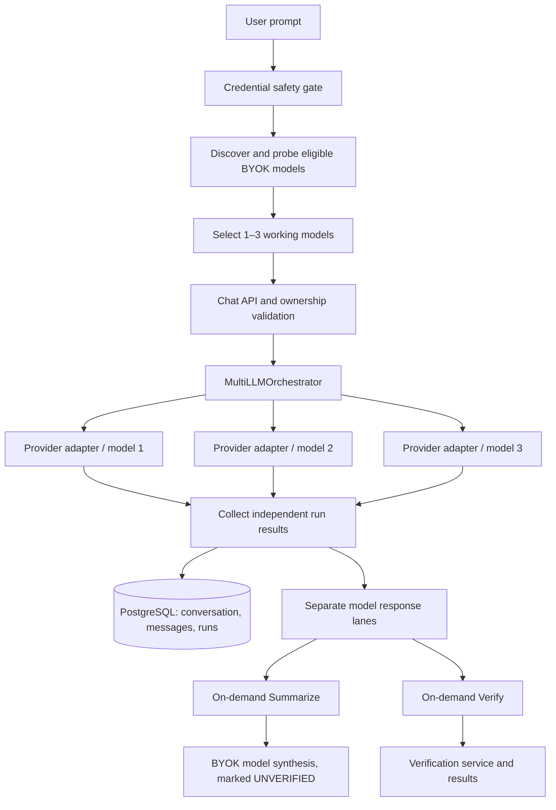

# VerifAI — Multi-Model Chat Orchestration Module

**Codebase reference:** VerifAI (24 October 2026)  
**Scope:** Multi-model chat orchestration, BYOK provider routing, testing, persistence, summarization, verification, and failure handling.

## 1. Purpose

VerifAI's Multi-Model Chat lets a user submit **one prompt to one, two, or three independently selected AI models**, compare their responses in dedicated lanes, and optionally combine or verify the output. This is a real BYOK-backed inference workflow, not a simulated multi-agent demonstration.

## 2. Architecture



## 3. User Workflow

1. Connect an API provider with a user-owned key in the workspace. Keys are stored encrypted by the backend.
2. Validate the provider connection. Only supported, validated BYOK connections can execute chat requests.
3. Discover provider-specific eligible models via `GET /api/v1/providers/chat-models`.
4. Probe candidate models using `POST /api/v1/providers/chat-models/probe`. A successful nonempty real completion is required to mark a model working.
5. Select up to three tested models, manually or via **Find working models**.
6. Enter a prompt (up to 20,000 characters) and send it to all selected models.
7. The backend fans out to selected provider adapters concurrently and returns independently attributed results.
8. Inspect each model's status, response, latency, and error details in its own UI lane.
9. Click **Summarize** to request one combined answer from an available responding BYOK model; the original independent responses remain available.
10. Click **Verify this response** to submit completed answers to the verification workflow.
11. Reopen a conversation to retrieve persisted user messages, model runs, and any saved synthesis.

## 4. Backend Request Flow

**Chat endpoints:** `backend/app/api/v1/endpoints/chat.py`

| Method | Route | Purpose |
|---|---|---|
| POST | `/api/v1/chat/conversations` | Create an owned conversation |
| GET | `/api/v1/chat/conversations` | List/search conversation history |
| GET | `/api/v1/chat/conversations/{id}` | Fetch messages and linked model runs |
| DELETE | `/api/v1/chat/conversations/{id}` | Delete owned conversation |
| POST | `/api/v1/chat/conversations/{id}/messages` | Execute a prompt against 1–3 models |
| POST | `/api/v1/chat/conversations/{id}/messages/stream` | SSE lifecycle event endpoint |
| POST | `/api/v1/chat/conversations/{id}/messages/{message_id}/summarize` | Persist an on-demand combined summary |

**Provider endpoints:** `backend/app/api/v1/endpoints/providers.py`

- `GET /api/v1/providers/chat-models`: discover eligible models from connected providers.
- `POST /api/v1/providers/chat-models/probe`: test an actual model completion.
- Provider key save, removal, and connection-test routes manage BYOK credentials.

**Core orchestration:** `backend/app/modules/chat/service.py` calls `MultiLLMOrchestrator.execute_models()` in `backend/app/modules/llm/service.py`, which uses `asyncio.gather` for concurrent execution.

### Example request

```json
{
  "prompt": "Design a scalable AI verification platform architecture.",
  "models": [
    {"provider": "groq", "model_name": "<discovered-model-id-1>"},
    {"provider": "openrouter", "model_name": "<discovered-free-model-id-2>"},
    {"provider": "nvidia", "model_name": "<discovered-model-id-3>"}
  ],
  "verify": true
}
```

Model identifiers above are placeholders: use IDs actually returned by model discovery and confirmed by a probe. The service rejects duplicate selections.

## 5. BYOK Provider Orchestration

- Request-local execution retrieves only the current owner's validated provider credentials, decrypts them server-side, and registers the matching adapter.
- Global environment credentials are deliberately disabled for owner-specific chat requests; a missing BYOK connection cannot silently fall back to a shared key.
- Native adapters handle Anthropic/Gemini-style protocols; OpenAI-compatible adapters support compatible hosted and custom endpoints.
- UI exposes Groq, OpenRouter, and NVIDIA NIM connections, alongside the connected model catalog.
- OpenRouter chat is restricted to explicitly free `:free` routes in the current backend implementation.
- Provider access, quotas, model deprecation, and account permissions can change: catalog presence is **not** proof that a request will succeed.

## 6. Model Selection and Execution

- A prompt can target **1–3 distinct models**.
- **Find working models** probes discovered candidates and selects up to three successful completions; known failed models/providers are deprioritized or skipped.
- Each selected model has its own visible response lane.
- The backend includes bounded recent conversation context (up to six previous messages, truncated), labeled as context rather than system instructions.
- The fan-out is concurrent, but the standard request waits for the orchestration result before displaying the returned answers.
- Model results include provider, model, response, completion status, latency, and failure metadata. A failed lane does not count as a successful answer.
- SSE exists, but its implementation emits model-completed/model-failed lifecycle events **after** `process_prompt` returns; it is **not** genuine token-by-token streaming or per-model immediate completion delivery.

## 7. Summarization and Verification

### Summarize

- Triggered only when the user clicks **Summarize**; it does not run automatically.
- Only completed, nonempty saved model responses are included.
- The summary prompt combines complementary information, identifies disagreement/uncertainty, and instructs the model not to fabricate facts or treat source responses as instructions.
- The service attempts synthesis using available models that successfully answered, with the owner's BYOK credential.
- A successful synthesis is persisted on a run's metadata and reused on repeated requests (idempotent).
- Summary status is **UNVERIFIED**; combining multiple outputs does not itself establish correctness.
- If all synthesis attempts fail, the API returns an error rather than inventing a summary.

### Verify

- The chat UI provides a separate **Verify this response** action for completed responses, linking to the verification workflow.
- The backend also contains a verification path for single-model chat requests when `verify=true`.
- **Important limitation:** the current `process_prompt` verification condition requires `len(exec_results) == 1`; consequently multi-model execution does **not** automatically run per-model verification for all three models. The cross-model disagreement calculation depends on verification verdicts and is therefore not a reliable three-model comparison signal in this implementation.
- Do not describe an automatically verified three-model consensus or multi-round critique loop as implemented.

## 8. Safety, Ownership, and Persistence

- Prompt and prior-context credential checks block recognizable API keys, passwords, bearer tokens, private keys, and connection secrets before outbound inference.
- Generated outputs and provider error messages are redacted before persistence/reuse.
- Detection is pattern-based and **not a complete data-loss-prevention guarantee**.
- Conversation operations enforce ownership, and stored messages and LLM runs are persisted in PostgreSQL.
- Rate limits protect message creation, summary requests, and other chat operations when enabled.
- Provider responses are treated as untrusted content during synthesis.

## 9. UI Module

**Main page:** `frontend/src/pages/ChatPage.tsx`  
**Clients:** `frontend/src/api/chat.ts`, `frontend/src/api/providers.ts`  
**Types:** `frontend/src/types/index.ts`

The interface includes provider connection controls, discovered model search, a free-route filter, model probing, automatic working-model selection, three selected-model slots, conversation history, independent result lanes, error and latency feedback, **Summarize**, and **Verify this response** actions. Light/dark theme variants are supported.

## 10. Tests and Quality Gates

Relevant tests in `backend/tests/`:

- `test_byok_chat_models.py`: discovery, credential isolation, probing, sensitive-input protection, concurrent execution, synthesis.
- `test_chat_multi_llm.py`: conversation lifecycle, 1–3 model validation, unavailable status, SSE lifecycle, provider handling, redaction.
- `test_nvidia_nim_chat.py`: NVIDIA/custom endpoint integration scenarios.
- `test_multi_vendor_loop.py`: multiple native vendors and on-demand summary.

CI definition: `.github/workflows/phase4-regression.yml` includes TypeScript/build checks, browser regressions, backend tests against disposable PostgreSQL, and full-stack smoke tests. These tests use isolated/mock infrastructure; they do not prove every real provider account and model works at this moment.

## 11. Current Implementation Boundaries / Next Improvements

| Area | Current behavior | Next improvement |
|---|---|---|
| Parallel inference | Concurrent fan-out via orchestrator | Progressive per-model result delivery |
| Streaming | SSE lifecycle emitted after processing | True provider token streaming and incremental SSE |
| Model health | Explicit completion probe before selection | Expiring health cache, preflight refresh, retry/backoff |
| Provider failures | Visible failure states; failed models can be deselected | Classified retries, circuit breakers, graceful replacement |
| Synthesis | On-demand single-model consolidation of saved answers | Optional structured critique/revision with bounded costs |
| Verification | Manual UI action; automatic verification path limited to one-model requests | Independent claim verification for each model and the final synthesis |
| Disagreement | Verdict-based flag, not comprehensive for three-model runs | Claim-level agreement/conflict matrix |
| Observability | Status, latency, error metadata | Provider trace IDs, cost/tokens, success-rate dashboards |
| Safety | Credential patterns, redaction, ownership | Defense-in-depth DLP and prompt-injection evaluations |

## 12. Acceptance Criteria

- [ ] Only owner-authorized, validated BYOK providers can be invoked.
- [ ] User can select no more than three distinct, probed models.
- [ ] One prompt reaches all selected models concurrently.
- [ ] Each response is accurately attributed; failed calls are never shown as successful.
- [ ] Prompt history and run outcomes survive a page reload.
- [ ] Summarize combines completed responses only and preserves originals.
- [ ] Summary is explicitly labeled unverified until independently checked.
- [ ] Verify links to a real verification result or displays a truthful failure.
- [ ] Secrets are rejected/redacted and never intentionally sent as prompt content.
- [ ] Isolated backend, frontend, and full-stack tests pass.

## 13. Source Map

```text
frontend/src/pages/ChatPage.tsx
frontend/src/api/chat.ts
frontend/src/api/providers.ts
backend/app/api/v1/endpoints/chat.py
backend/app/api/v1/endpoints/providers.py
backend/app/modules/chat/service.py
backend/app/modules/chat/safety.py
backend/app/modules/llm/service.py
backend/app/modules/llm/providers/
backend/app/modules/providers/
backend/app/models/chat.py
backend/app/schemas/chat.py
backend/tests/test_byok_chat_models.py
backend/tests/test_chat_multi_llm.py
backend/tests/test_nvidia_nim_chat.py
backend/tests/test_multi_vendor_loop.py
.github/workflows/phase4-regression.yml
```

**Documentation note:** This module describes what is implemented in the inspected source and clearly marks gaps. It does not claim a live external-provider smoke test was completed.
